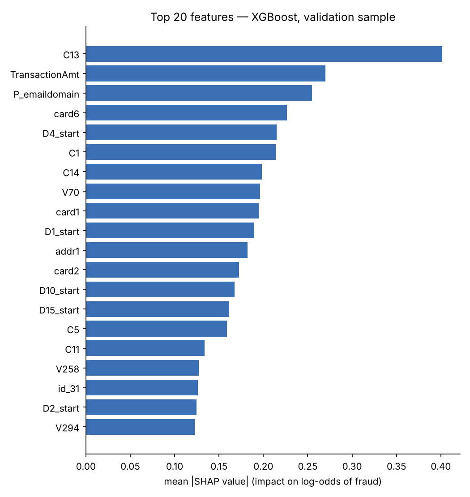

# FraudShield

Real-time card fraud detection: a simulator streams transactions, a trained model scores each one in under 50 ms, and analysts review flagged alerts on a live dashboard.

> **Status:** Week 2 done. The model, features, tuning, explanations and model registry are in place. The scoring API arrives in week 3.

## Results so far

All numbers come from the IEEE-CIS data (590,540 transactions, 3.5% fraud), using a time-based split: train on the earliest 70%, validate on the next 15%, test on the last 15%. Thresholds and model choice use validation only. Test is scored once, at the end.

| Model | Val PR-AUC | Test PR-AUC | Val → test drop |
|---|---|---|---|
| Logistic regression (week 1 baseline) | 0.386 | 0.166 | 57% |
| XGBoost, raw columns only | 0.610 | 0.524 | 14% |
| XGBoost + row features | 0.647 | 0.535 | 17% |
| XGBoost + row + history features | 0.636 | **0.542** | 15% |
| Same, Optuna-tuned (registered champion) | **0.643** | 0.538 | 16% |

Random guessing scores about 0.035, the fraud rate.

**What the ablation shows:**

- **XGBoost is most of the gain.** Switching from a linear model to XGBoost lifted test PR-AUC from 0.17 to 0.52. Most of the large val → test drop in week 1 was a linear-model problem: boosted trees cope far better with drifting columns.
- **The engineered features add a little on test (+0.018).** The rewritten D columns (`D4_start`, `D1_start`, …) are among the strongest features in the model.
- **Tuning did not move test.** Ten Optuna trials (100 minutes on 2 CPU cores) found settings that do slightly better on validation and slightly worse on test. That is within noise. The tuned model is the registered champion because the champion rule looks at validation only, as it should. More trials on a faster machine are an easy future improvement.

At the cost-optimal threshold (a missed fraud costs $100, a false alarm $5), the champion catches **69% of fraud on test**, and about 1 in 4 flagged transactions is actually fraud.



## Quick start

```bash
git clone https://github.com/YxgxPxtxl/fraudshield.git
cd fraudshield
make setup            # create .venv and install ML dependencies
make data             # download IEEE-CIS data from Kaggle (needs Kaggle CLI + accepted rules)
make train-baseline   # week 1 logistic regression baseline
make tune             # Optuna search -> ml/params/xgb_best.json (TRIALS=30 TUNE_MIN=60)
make train            # XGBoost with the tuned params; registers "fraudshield" in MLflow
make mlflow           # open the MLflow UI at http://localhost:5000
make test             # run the test suite
```

A full `make train` takes about 25 minutes on 2 cores and peaks at about 4.5 GB of RAM.

Load the champion model anywhere:

```python
import mlflow

model = mlflow.pyfunc.load_model("models:/fraudshield@champion")
model.predict(transactions_df, params={"top_k": 3})
# -> score, is_fraud, reasons (top features pushing the score up, as JSON)
```

## Repository layout

```
ml/          training, features, tuning, evaluation (Python)
  src/features.py   row + past-only history features, FeatureBuilder
  src/model.py      FraudScorer (score + SHAP reasons) and the MLflow wrapper
  src/train.py      train, evaluate, register, promote
  src/tune.py       Optuna search
  params/           tuned hyperparameters and trial log
api/         FastAPI scoring service           (week 3)
stream/      Redpanda producer + consumer      (week 4)
dashboard/   React + Vite live dashboard       (week 5)
monitoring/  Evidently drift reports           (week 5)
scripts/     data download and helpers
docs/        figures and results spreadsheets
```

## Design decisions

- **Time-based split, not random.** A random split leaks future behaviour into training and inflates scores.
- **PR-AUC as the headline metric.** Fraud is a small minority class, so accuracy means nothing here: predicting "not fraud" every time scores about 96%. PR-AUC and recall at a fixed precision reflect what an analyst actually sees.
- **The threshold is set by cost, not by 0.5.** It is chosen on validation to minimise $100 × missed fraud + $5 × false alarms.
- **Drifting "days since" columns are rewritten as "the day it started"** (`day − Dn`). They then stay constant for a card instead of growing over time.
- **History features only look backwards.** Counts and spend per card and per client in the last hour or day, the gap since the previous transaction, and the amount compared with that card's past average. No labels are used, so the same logic can run on a live stream (Redis in week 3).
- **Unseen categories become missing.** XGBoost handles missing values natively, so a new email domain at serving time can't crash the model.
- **Explanations without an extra library.** XGBoost's built-in TreeSHAP (`pred_contribs`) gives every score its top reasons. The dashboard will show them to analysts.
- **One model artifact carries everything.** The MLflow model bundles the booster, the feature builder and the threshold. The `champion` alias moves only when a new version beats the current one on validation.
- **Raw data never enters git.** Only `scripts/download_data.sh` is committed. Check the Kaggle dataset rules before publishing anything derived from it.

## License

MIT — see [LICENSE](LICENSE).
